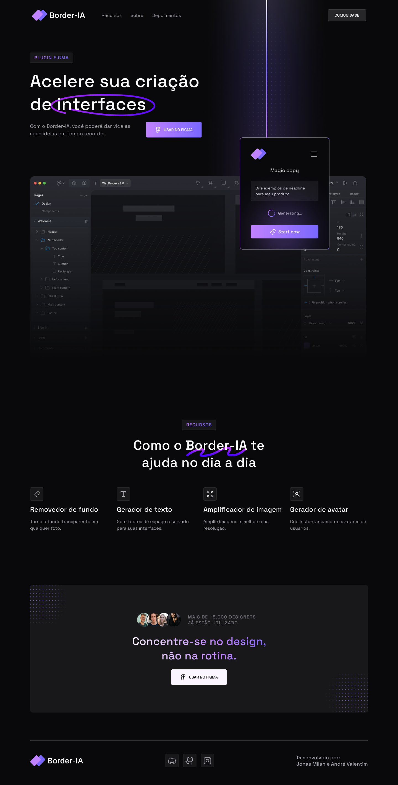
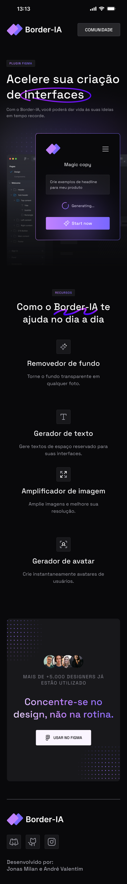
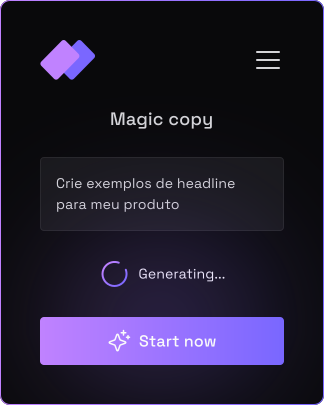
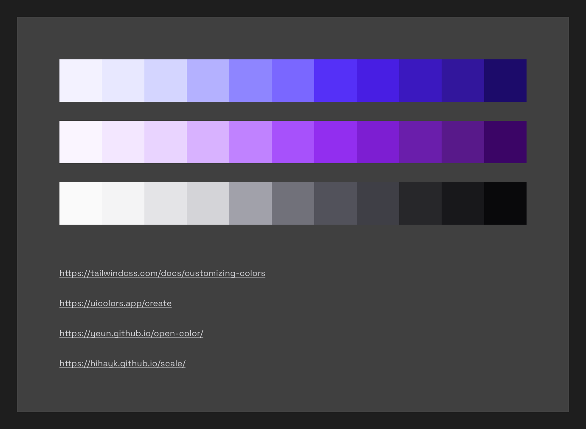
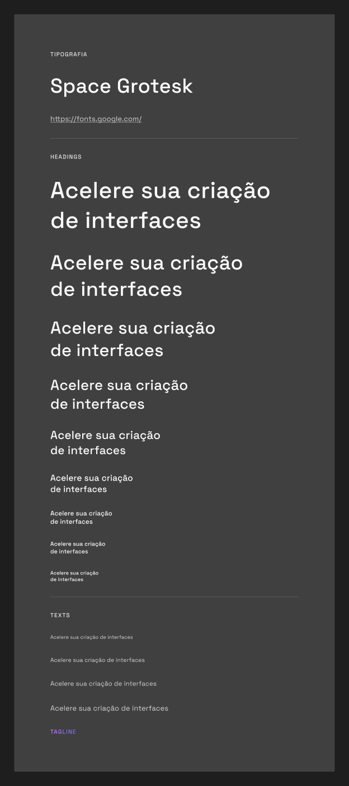

<p align="center">
  
</p>

<h1 align="center">Border-IA: Landing Page e Design Showcase</h1>

<p align="center">
  Landing page promocional do plugin de inteligencia artificial generativa para Figma. O projeto combina fidelidade visual ao layout original, microinteracoes fluidas com GSAP, renderizacao 3D progressiva via Three.js e testes automatizados em ambiente Node.js puro.
</p>

<p align="center">
  
  
  
  
  
  
  
  
</p>

---

## Sumario

- [Proposta do Projeto](#proposta-do-projeto)
- [Previews Visuais e Telas](#previews-visuais-e-telas)
- [Design System e Paleta de Cores](#design-system-e-paleta-de-cores)
- [Tipografia](#tipografia)
- [Recursos do Plugin](#recursos-do-plugin)
- [Engenharia de Interatividade e Movimento](#engenharia-de-interatividade-e-movimento)
- [Arquitetura de Codigo](#arquitetura-de-codigo)
- [Como Executar Localmente](#como-executar-localmente)
- [Creditos](#creditos)

---

## Proposta do Projeto

O Border-IA e um plugin para Figma desenvolvido para potencializar a produtividade de equipes de design e acelerar o desenvolvimento de interfaces digitais. A ferramenta resolve tarefas manuais repetitivas direto no canvas de trabalho, disponibilizando geracao de copy contextual, remocao instantanea de fundos, ampliacao de imagens e criacao de avatares realistas.

Esta landing page foi construida para refletir com rigor o layout criado no Figma, atendendo aos seguintes objetivos tecnicos:
- Fidelidade estrita aos nodes Desktop (1440px) e Mobile (430px).
- Interatividade avançada com shaders WebGL, mola fisica no feixe de luz e malha pontilhada acoplada ao cursor.
- Performance de carregamento sem travamentos de thread principal, com suporte a prefers-reduced-motion e fallback dinamico para navegadores sem WebGL.

---

## Previews Visuais e Telas

A interface foi estruturada em duas bases principais do Figma: `Desktop` (node `307:78`, largura 1440px) e `Mobile` (node `335:10650`, largura 430px). O conteudo util e centralizado em 1216px no desktop, garantindo leitura confortavel e alinhamento consistente.

<p align="center">
  
  &nbsp;&nbsp;
  
</p>

### Mockups da Interface do Plugin

No Hero da pagina, o card interativo **Magic copy** simula a execucao real do plugin dentro do Figma, com estado "Generating..." e iluminacao integrada.

<p align="center">
  
</p>

---

## Design System e Paleta de Cores

O projeto adota uma paleta em modo escuro profundo, tendo como base estrutural o tom Gray-11 (`#09090B`). A identidade cromatica combina tons de roxo (`Purple`) para a marca e acentos primarios, com tons de indigo (`Indigo`) para profundidade, feixes de luz e sombras tecnicas.

<p align="center">
  
</p>

### Tabela de Tokens de Cor

Abaixo estao mapeadas as tres escalas cromáticas do Figma, configuradas no tema do Tailwind CSS em `src/app/globals.css`:

| Nivel | Gray (Neutros de Apoio) | Purple (Marca e Destaque) | Indigo (Luz e Profundidade) |
|---|---|---|---|
| **01** | `#FAFAFA` (Texto principal) | `#FAF5FF` | `#F3F2FF` |
| **02** | `#F4F4F5` | `#F3E7FF` | `#E8E8FF` |
| **03** | `#E4E4E7` | `#E9D4FF` | `#D4D5FF` |
| **04** | `#D4D4D8` (Bordas e icones) | `#D8B2FF` | `#B4B1FF` |
| **05** | `#A1A1AA` (Texto secundario) | `#C082FF` (Acento gradiente) | `#8E85FF` |
| **06** | `#71717A` | `#A751FB` (Selecao e cursor) | `#7A67FF` (Acento gradiente) |
| **07** | `#52525B` | `#922EEF` | `#5530F7` |
| **08** | `#3F3F46` | `#7D1ED2` | `#481EE3` |
| **09** | `#27272A` (Bordas de cards) | `#6A1EAB` | `#3B18BF` |
| **10** | `#18181B` (Fundo de cards) | `#58198A` | `#32169C` |
| **11** | `#09090B` (Fundo da pagina) | `#3B0566` | `#1C0B6A` |

### Gradientes e Efeitos de Superficie

- **Linear-degrade**: `linear-gradient(90deg, #C082FF 0%, #7967FF 100%)`. Aplicado nos botoes CTA, tags de secao e halos luminosos.
- **Banner-heading**: `linear-gradient(90deg, #FFFFFF 6.6%, #C082FF 64.94%, #7967FF 106.28%)`. Utilizado no titulo de fechamento da landing page.
- **Brilho Dinamico (.btn-shine)**: Gradiente angular movido via `@property --shine-angle` no hover e no clique dos botoes de acao.
- **Selecao de Texto**: Cor personalizada da marca configurada em `::selection` com `rgb(167 81 251 / 0.45)`.

---

## Tipografia

A identidade visual utiliza exclusivamente a familia tipografica **Space Grotesk**, equilibrando clareza tecnica e personalidade contemporanea.

<p align="center">
  
</p>

### Hierarquia Tipografica Desktop

| Estilo | Peso | Tamanho | Altura de Linha | Uso Principal |
|---|---|---|---|---|
| **H1** | 500 (Medium) | 64px (clamp dinamico) | 1.3 | Titulo de abertura do Hero |
| **H2** | 500 (Medium) | 48px | 1.3 | Titulo da secao de Recursos |
| **H3** | 500 (Medium) | 40px | 1.3 | Titulo do Banner de conversao |
| **H6** | 500 (Medium) | 24px | 1.3 | Titulos dos cards de recursos |
| **tag-text** | 500 (Medium) | 16px | 1.3 | Badges superiores das secoes |
| **p-18** | 400 (Regular) | 18px | 1.5 | Subtitulo do Hero |
| **p-16** | 400 (Regular) | 16px | 1.5 | Descricoes de funcionalidades e cards |
| **p-14** | 400 (Regular) | 14px | 1.5 | Legendas de interface e navegacao secundaria |

---

## Recursos do Plugin

A secao de recursos apresenta os quatro pilares funcionais do Border-IA:

1. **Removedor de fundo**: Torna transparente o fundo de qualquer fotografia em segundos, sem necessidade de softwares externos.
2. **Gerador de texto**: Cria copys, headlines e blocos de conteudo contextual diretamente nos componentes da interface.
3. **Amplificador de imagem**: Restaura detalhes e amplia a resolucao de fotografias e ilustracoes com redes neurais.
4. **Gerador de avatar**: Produz instantaneamente avatares realistas para listas de usuarios, contatos e depoimentos.

A prova social no banner final destaca a adocao da ferramenta: *"Mais de +5.000 designers ja estao utilizando"*.

---

## Engenharia de Interatividade e Movimento

O projeto foi construido com um conjunto de microinteracoes orquestradas para proporcionar uma experiencia tátil e imersiva:

### 1. Cursor com Malha Pontilhada Dinamica (CursorDotMesh)
- O ponteiro padrao do sistema e suspenso em telas desktop para dar lugar a uma matriz 2D de pontos (88x88 pixels, 484 celulas) desenhada em Canvas.
- O campo utiliza atenuacao radial combinada com dither espacial de matriz de Bayer 4x4, criando transicao suave nas bordas.
- Ao sobrevoar links e botoes, a malha se expande de forma elastica. Quando o mouse para, o loop de animacao entra em repouso para economizar bateria e ciclos de CPU.

### 2. Feixe de Luz Conectado (HeroBeam)
- Conecta a janela do Figma ao card 3D do plugin por meio de um feixe luminoso.
- O cabo simula uma mola fisica de segunda ordem com amortecimento critico, reagindo ao movimento do card sem perder a ancoragem geometrica.
- Utiliza Three.js e React Three Fiber em telas desktop, com fallback visual em curva SVG para dispositivos sem suporte a WebGL.

### 3. Inclinacao 3D do Card Magic Copy
- O card flutua com um balanco sutil continuo em eixos tridimensionais (rotateX, rotateY e rotateZ).
- Ao passar o mouse sobre o card, o balanco da lugar a uma inclinacao precisa que segue a posicao do ponteiro, com retorno amortecido ao estado neutro.

### 4. Animacao de Tracados e Textos
- A palavra "interfaces" no Hero e envolta por um contorno desenhado progressivamente.
- O titulo da secao de Recursos recebe um rabisco decorativo animado por GSAP atraves da manipulacao de `stroke-dashoffset`.
- Scroll suave da pagina gerenciado pela biblioteca Lenis.

---

## Arquitetura de Codigo

```text
border-ia/
├── docs/
│   ├── design/              # Assets exportados do Figma, telas e documentacao visual
│   ├── handoff/             # Handoffs de especificacao e alinhamento
│   └── review/              # Relatorios de code review, desempenho e seguranca
├── public/
│   ├── icons/               # SVGs de icones, logotipos e marcas de rede social
│   └── images/              # Imagens otimizadas em WebP e mockups de interface
├── specs/                   # Especificacoes de engenharia e planos Spec-Kit
│   ├── 005-malha-hover-hero/
│   ├── 006-onda-e-malha-cursor/
│   └── 007-testes-vitest/
├── src/
│   ├── app/                 # Next.js App Router (layout, page e globals.css)
│   ├── components/
│   │   ├── motion/          # CursorDotMesh, controladores GSAP e Lenis
│   │   ├── sections/        # Header, HeroSection, FeaturesSection, Banner e Footer
│   │   ├── three/           # Shaders WebGL2, HeroBeamCanvas e PluginPrismLogo
│   │   └── ui/              # CtaButton, MagicCopyCard, MaskIcon e TagBadge
│   ├── lib/                 # Modulos matematicos puros e helpers testaveis
│   ├── security/            # Suites estaticas de seguranca de assets e codigo
│   └── types/               # Tipos e contratos TypeScript
├── package.json
├── tsconfig.json
└── vitest.config.ts         # Configuracao de testes unitarios em ambiente node
```
<!--

### Qualidade de Codigo e Seguranca
- **Testes Unitarios com Vitest**: Logica matematica de animacao, molas fisicas, limites de tela e seguranca de links cobertos em suites de execucao rapida (< 2s).
- **Sem Novas Dependencias Desnecessarias**: A suite unitaria roda em ambiente `node` nativo, sem inflar dependencias em tempo de execucao.
- **Auditoria de Seguranca**: Codigo revisado contra normas de seguranca da informacao, sem presenca de `eval`, sem sinks de HTML perigosos e com saneamento de links externos com `rel="noopener noreferrer"`.

---

## Como Executar Localmente

### Pre-requisitos
- Node.js versao 20 ou superior.
- Gerenciador de pacotes npm.

### Passo a Passo

1. Clone o repositorio:
   ```bash
   git clone https://github.com/joao-gabriel/border-ia.git
   cd border-ia
   ```

2. Instale as dependencias:
   ```bash
   npm install
   ```

3. Inicie o servidor de desenvolvimento:
   ```bash
   npm run dev
   ```
   Acesse a aplicacao em `http://localhost:3000`.

4. Execute os testes unitarios:
   ```bash
   npm test
   ```

5. Gere a versao de producao:
   ```bash
   npm run build
   npm run start
   ```
-->
---

## Creditos

Desenvolvido por: **João Gabriel**.

Projeto baseado na interface desenhada para o plugin Border-IA no Figma (file key `9INxBOvGlTfRVQ15bnmNwy`).
